# Benchmark figures

Static figures of the results in [REPORT.md](../REPORT.md). Each figure is saved as a PNG (for viewing) and a PDF (vector, for papers). They are drawn from the summary CSVs in the parent folder; no benchmark is rerun. Regenerate with:

```bash
.venv/bin/python scripts/plot_figures.py
```

**Colour key, used in every figure.** Blue = moment matching (eigen, Gaussian, MVN). Orange = soft / Gumbel relaxation. Green = optimal transport (OT, corrected OT). Gray = classical resampling; dark gray = classical with stop-gradient. Marker shape repeats the family, and every row or line is also labelled by name. Whiskers are 95% intervals unless the figure says otherwise.

## Static resampling

### 1. Gaussian-mixture distribution error, moments and cost

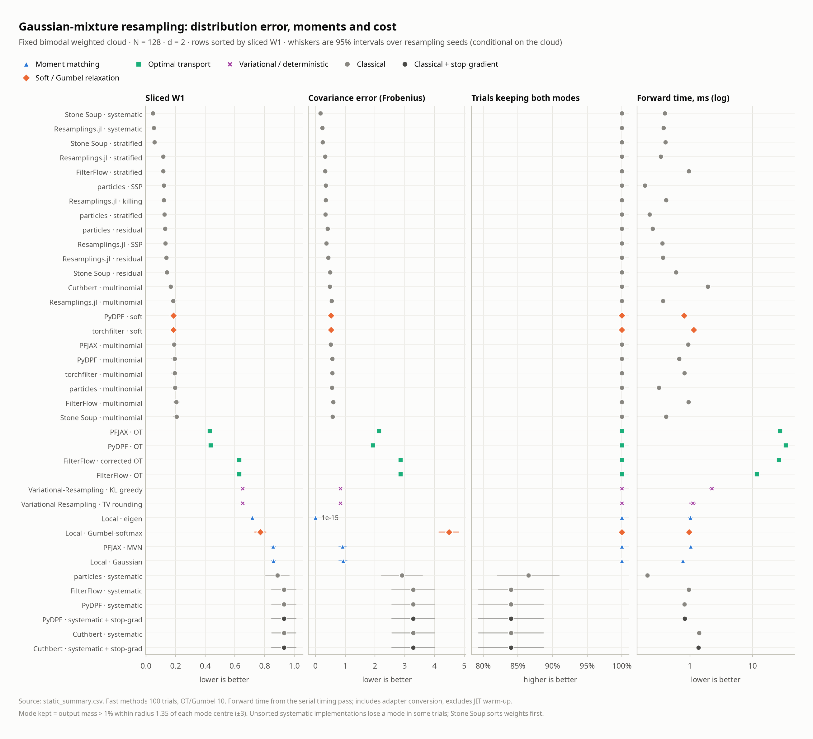

Fixed bimodal cloud, N = 128, d = 2. Stone Soup systematic has the lowest sliced W1 (0.047). Eigen matches covariance to 1e-15 but has a sliced W1 of 0.72. Systematic implementations that do not sort the weights keep both modes in only 84–87% of trials. OT takes 12–34 ms per call; every other method takes 0.2–2 ms.

### 2. Distribution error versus forward time

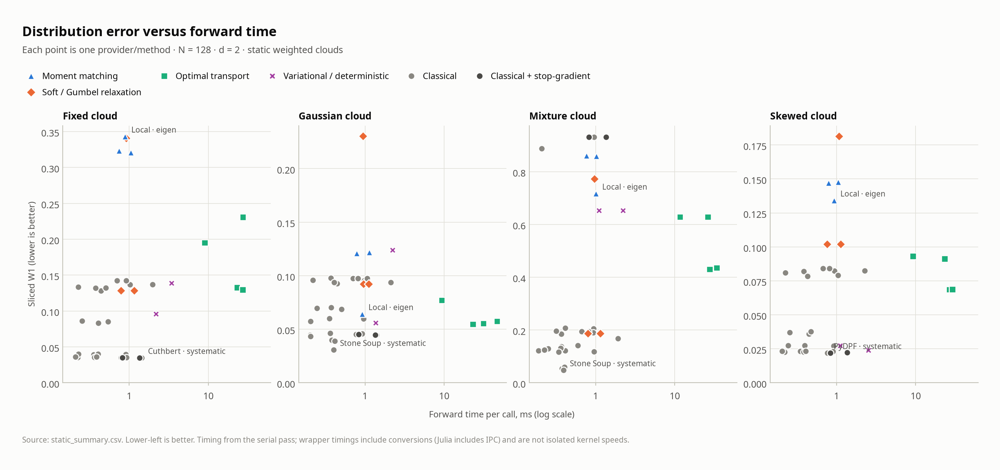

All four static clouds at N = 128, d = 2. Lower left is better.

### 3. Distribution error as N grows

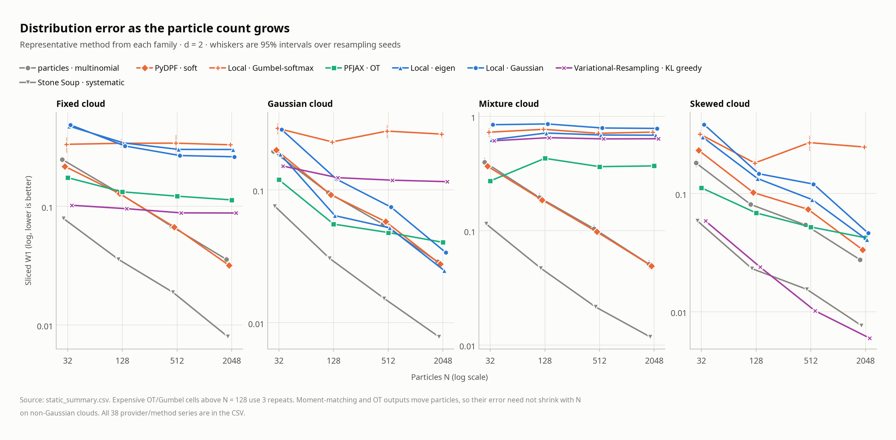

Error for the two classical methods shown falls steadily with N. Systematic implementations that do not sort the weights stay near 0.9 on the mixture (see the CSV). On the mixture cloud at N = 2048, eigen (0.69) and PFJAX OT (0.37) level off well above classical resampling. On the Gaussian cloud, eigen falls to 0.025.

### 4. CPU forward-time scaling

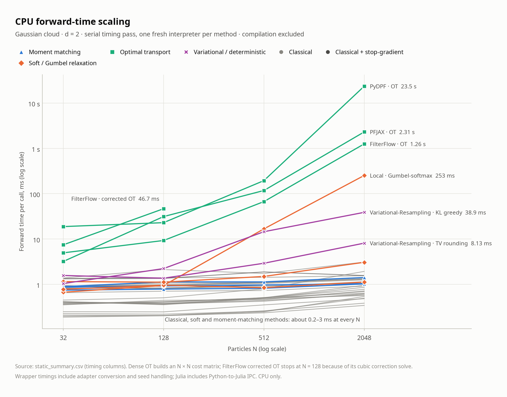

Gaussian cloud, d = 2, serial timing pass. At N = 2048, one call takes 23.5 s with PyDPF OT, 2.31 s with PFJAX OT, 1.26 s with FilterFlow OT and 253 ms with Gumbel-softmax. Every other method stays at about 0.2–3 ms.

### 5. Process peak memory

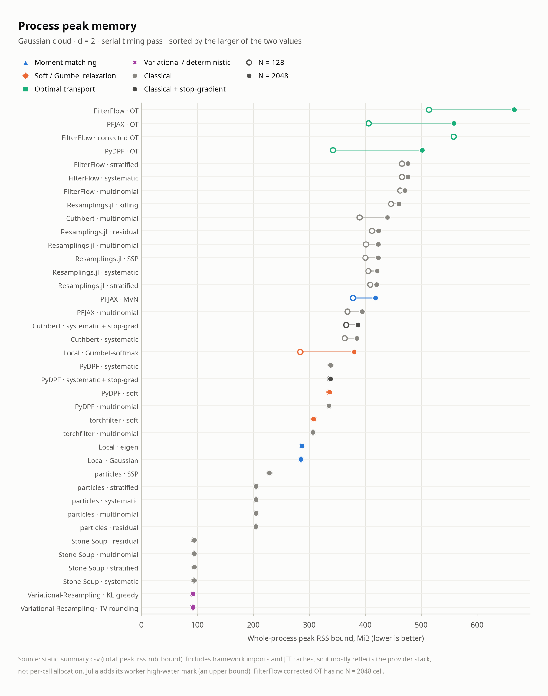

Whole-process peak RSS bound at N = 128 (hollow) and N = 2048 (filled): 94 MiB (Stone Soup) to 666 MiB (FilterFlow OT, N = 2048). Most of this is framework imports and JIT caches, not per-call allocation.

## Filtering

### 6. Filtering RMSE at N = 128

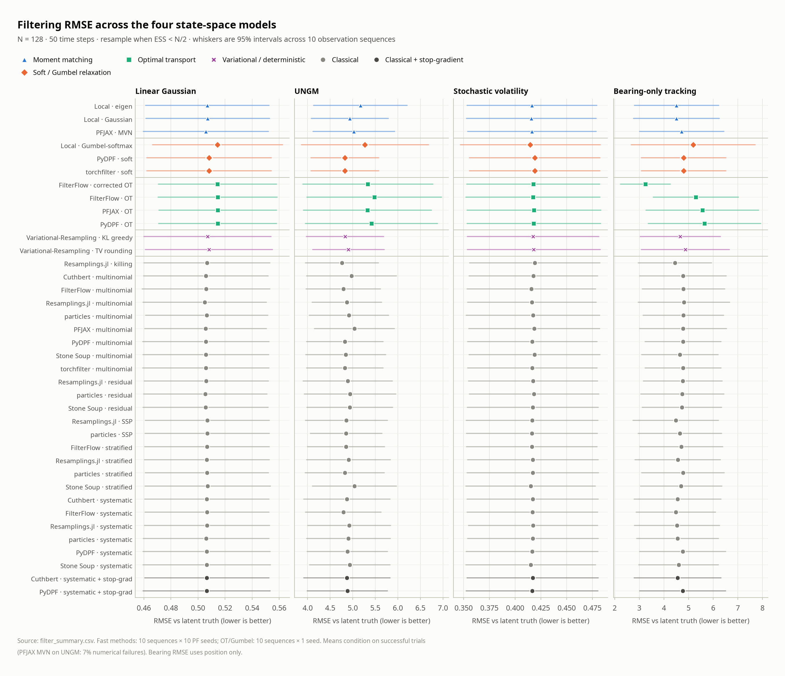

On the linear and volatility models, the method means are close and all intervals overlap. On bearing-only tracking, FilterFlow corrected OT has the lowest mean RMSE (3.25) and plain OT the highest (5.3–5.6).

### 7. Calibration: 95% Gaussian-ellipsoid coverage

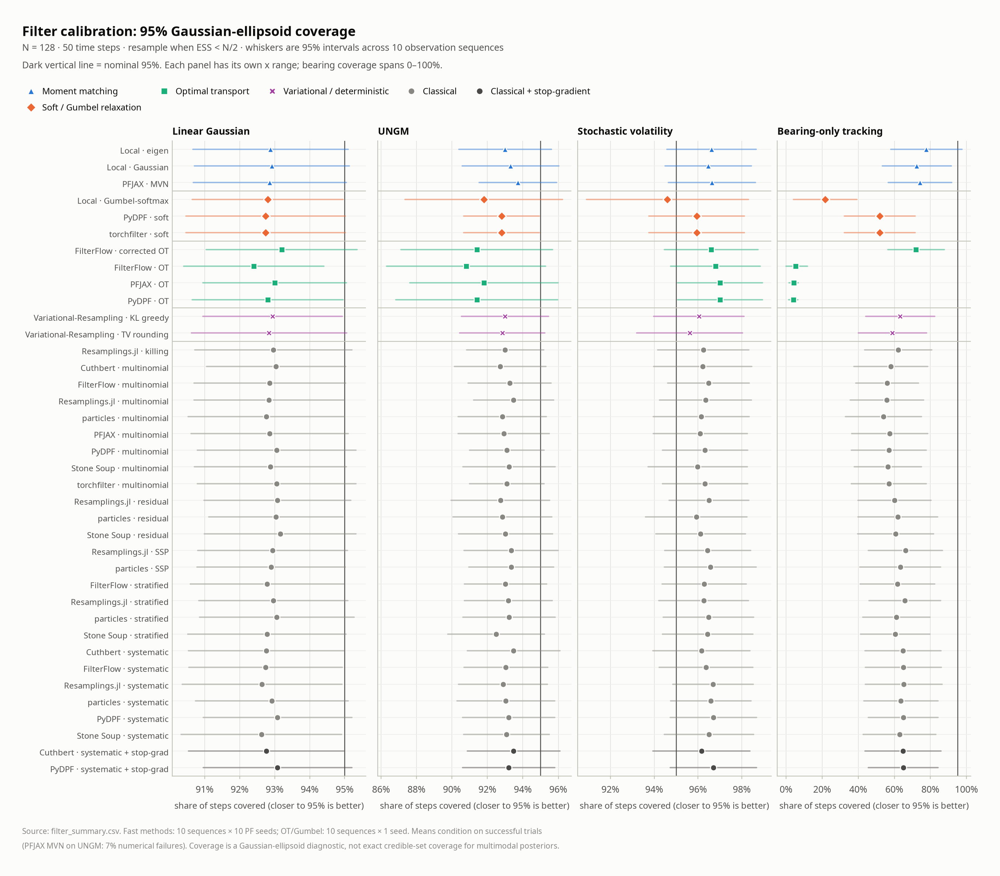

On the linear model, every method covers 92–93% against a nominal 95%. For bearing-only tracking, coverage is 78% for eigen, 72% for corrected OT, 54–66% for classical methods and only 4–5% for plain OT.

### 8. Filtering RMSE as N grows

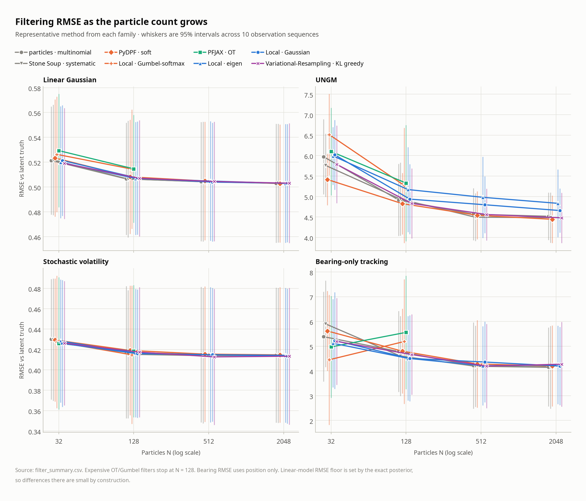

Representative method from each family. Points are shifted slightly sideways so overlapping whiskers stay visible.

### 9. Bearing-only recovery after the observation gap

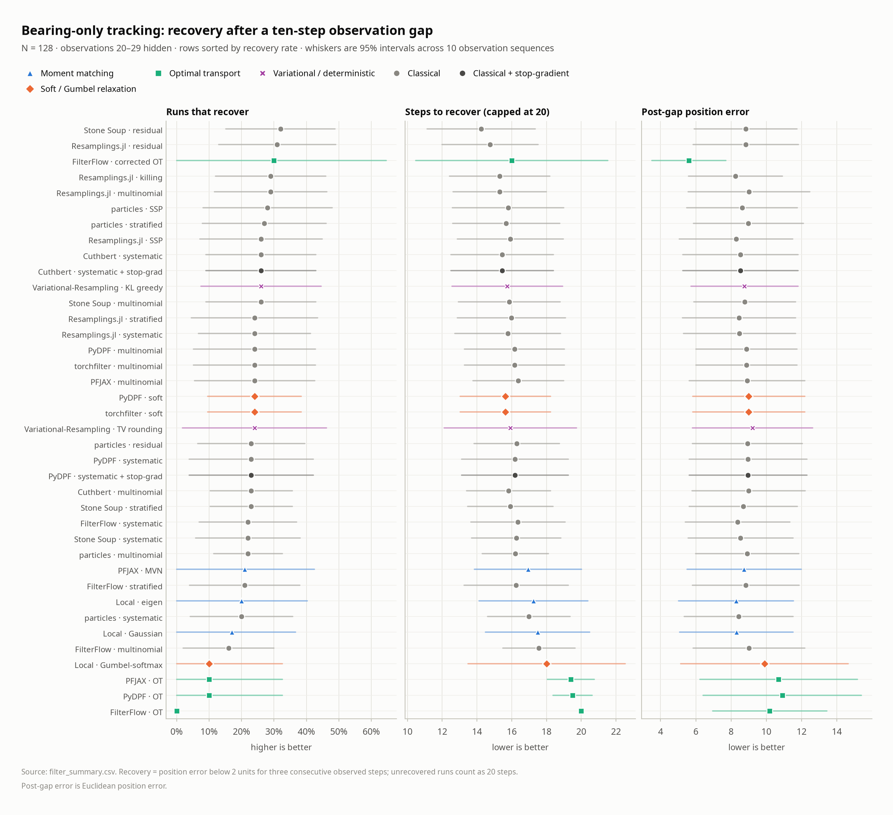

Between 0% (FilterFlow OT) and 32% (Stone Soup residual) of runs recover. Intervals are wide.

## Gradients and learning

### 10. Local expectation gradients through one resampling step

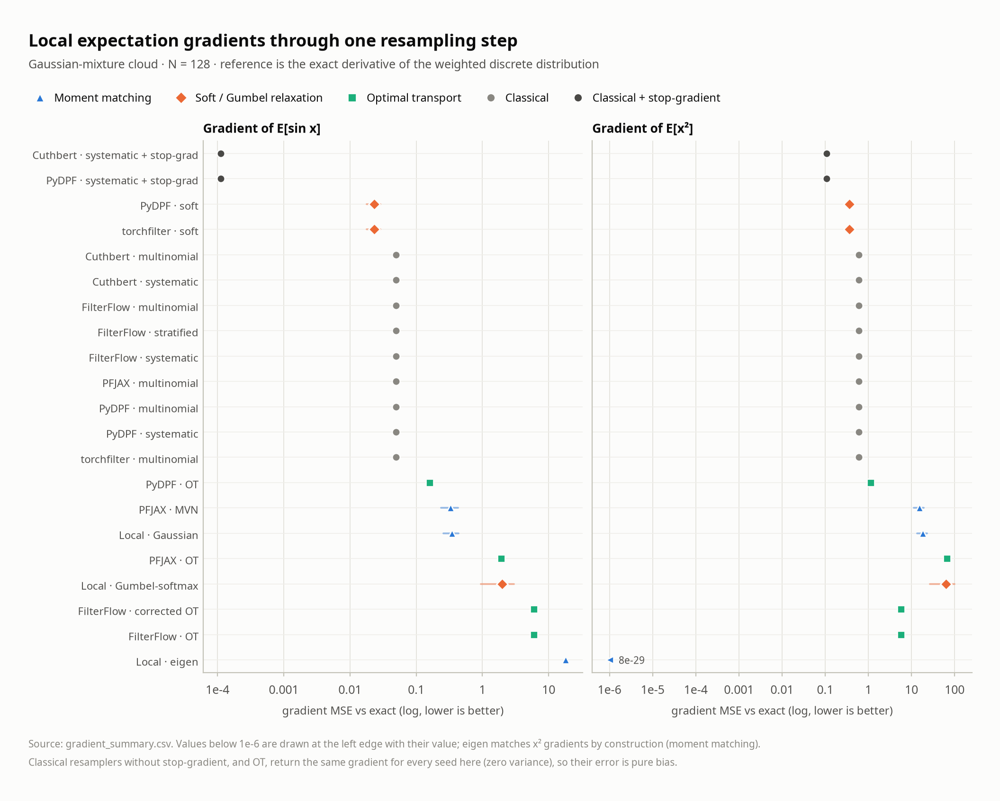

Mixture cloud, N = 128. Eigen is exact for the x² gradient (8e-29) because it matches moments, but it has the largest sin-gradient error. Stop-gradient systematic has the lowest sin-gradient error.

### 11. Likelihood gradients against the exact Kalman gradient

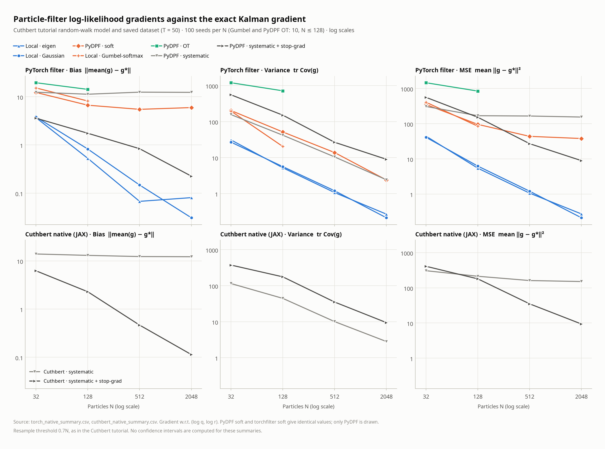

Top row: PyTorch filter. Bottom row: native Cuthbert (JAX). Same saved dataset in both. Plain systematic bias stays near 12 at every N. Stop-gradient bias falls with N (0.23 PyDPF, 0.11 Cuthbert at N = 2048). Eigen and Gaussian have the lowest MSE at every N measured.

### 12. Cuthbert likelihood and gradient profiles

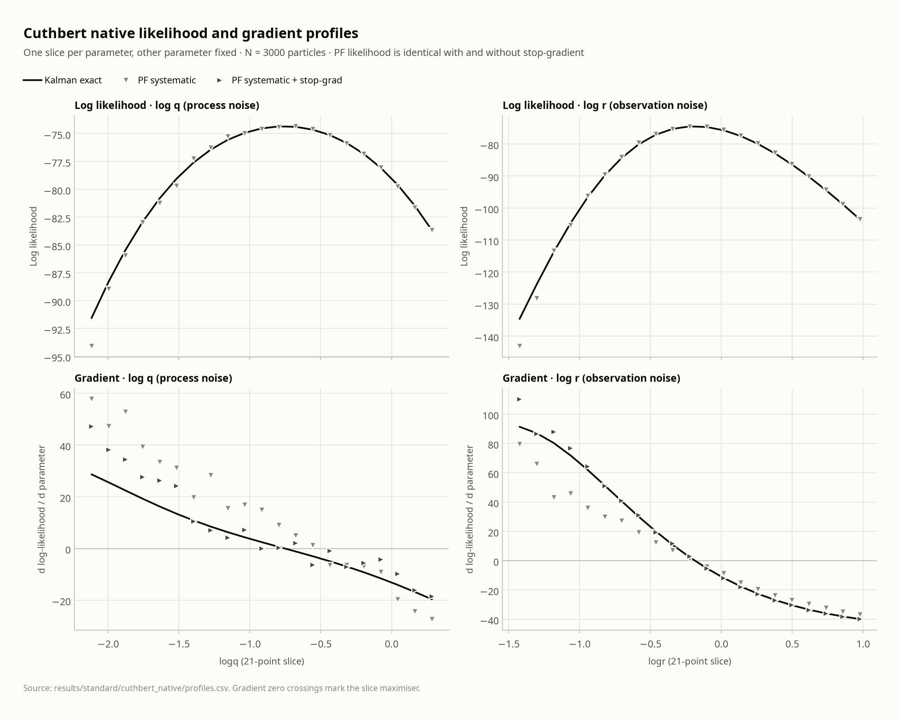

N = 3000. The PF log likelihood follows the Kalman curve. Plain-PF gradients are offset from the exact gradient over much of each slice; stop-gradient estimates scatter around it.

### 13. Stochastic-volatility scale learning

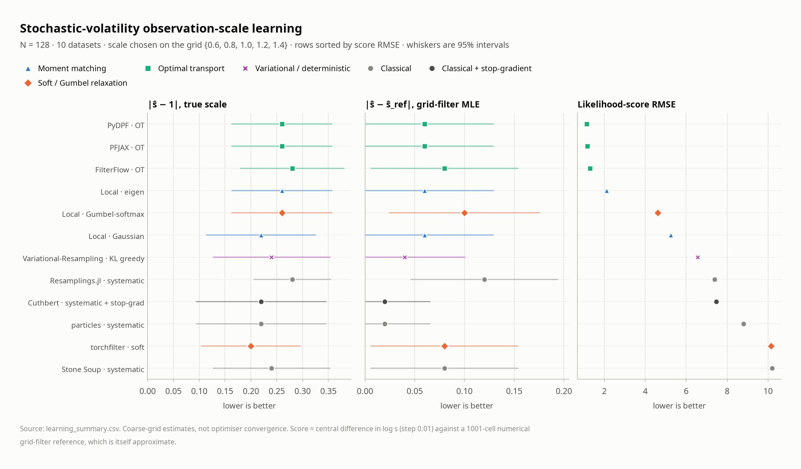

Scale errors (0.20–0.28) overlap for every method. Likelihood-score RMSE is lowest for OT (1.15–1.31), then eigen (2.11), with classical methods at 7.4–10.2.

## Reading limits

These figures inherit every caveat in [REPORT.md](../REPORT.md#metric-definitions-and-measurement-limits). Results are CPU only. Timings are wrapper timings. Means condition on successful trials. OT and Gumbel cells use fewer repeats. Expensive filters stop at N = 128.
